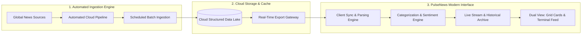

# PulseNews Intelligence Platform 🌐⚡

> A modern, real-time news intelligence and streaming dashboard engineered for high-frequency news tracking, automated cloud feed ingestion, sector-based categorization, and interactive discovery.

---

## 📌 Overview

**PulseNews** bridges automated cloud data collection with a high-performance web dashboard. It continuously ingests, organizes, and streams breaking stories across global tech, markets, cybersecurity, and world news, delivering an uncluttered, ad-free reading and intelligence experience.

The platform provides dual operational streams:
1. **Latest News Feed**: Continuously updated live stream of breaking stories, market movements, and tech alerts.
2. **Old News Archive**: Deep historical repository allowing analysts and readers to explore past events, trends, and archival records.

---

## 🏗️ System Architecture & How It Works

PulseNews operates on a decoupled, three-tier architecture ensuring zero infrastructure overhead, rapid data delivery, and sub-second UI responsiveness:



### 1. Ingestion & Aggregation
- Automated background pipelines poll global media feeds and APIs on a continuous schedule.
- Raw articles, headlines, publisher metadata, and timestamps are normalized and stored in a cloud-hosted structured data lake.

### 2. Client-Side Data Sync & Resilience
- When users load the application, the client establishes a fast, non-blocking connection to the cloud data gateway.
- **Fail-Safe Offline Mode**: If network latency occurs, the client automatically falls back to an offline snapshot cache in `localStorage`, guaranteeing zero downtime.
- **Auto-Sync Engine**: An optional live-sync watcher checks for newly published stories in the background without refreshing the page.

### 3. Intelligent Classification & Filtering
- Ingested articles pass through an automated classification system that assigns sector tags:
  - 🤖 **AI & Deep Tech**
  - 📈 **Markets & Economy**
  - 🖥️ **Hardware & Chips**
  - 🛡️ **Cybersecurity & Dev**
  - 🪙 **Crypto & Web3**
  - 🏷️ **Deals & Consumer**
  - 🎮 **Entertainment & Gaming**
  - 📰 **General News**
- High-resolution publication favicons and contextual dynamic badges (`Top Story`, `Market Alert`, `Deep Dive`, `Breaking`) are automatically resolved and attached.

---

## ✨ Key Features

- **⚡ Real-Time Live Feed**: Live updates displaying breaking stories as they are aggregated.
- **🏛️ Historical News Archive**: Seamlessly toggle to historical archives to research past reports and chronological developments.
- **🔎 Instant Multi-Field Search**: Real-time search by headline, body summary, or publisher with instant feedback.
- **📊 KPI Intelligence Bar**: At-a-glance platform metrics showing total ingested stories, active publisher count, dominant sectors, and latest sync latency.
- **📰 Dual Layout Listing Modes**:
  - **Grid Cards View**: Visual magazine-style layout featuring read time estimates, publisher branding, and snippet cards.
  - **Dense Terminal Feed View**: Compact tabular format designed for rapid news scanning and high-density monitoring.
- **📖 Focused Reader View**: Read sanitized article previews with one-click links to original publisher sources.
- **🔖 Local Bookmarks / Reading List**: Save articles locally to your personal reading list with single-click bookmarking.
- **🌓 Dynamic Theme Support**: Clean, high-contrast **White (Light)** default theme with an instant toggle to a sleek **Dark Mode**.
- **🚀 60 FPS Progressive Windowing**: Windowed slice rendering guarantees instantaneous tab switching and zero UI lag even across thousands of archived stories.

---

## 🛠️ Technology Stack

- **Frontend Core**: [React 19](https://react.dev/) + [Vite](https://vitejs.dev/)
- **Styling**: Modern CSS Design System (CSS Custom Properties, Glassmorphism, Responsive Flex/Grid)
- **Icons**: [Lucide React](https://lucide.dev/)
- **Data Parsing**: [PapaParse](https://www.papaparse.com/)
- **Typography**: Plus Jakarta Sans & JetBrains Mono

---

## 🚀 Getting Started

### Prerequisites
- [Node.js](https://nodejs.org/) (v18.0.0 or higher recommended)
- `npm` or `yarn`

### Installation

1. **Clone the repository**:
   ```bash
   git clone https://github.com/your-username/rag-news-website.git
   cd rag-news-website
   ```

2. **Install dependencies**:
   ```bash
   npm install
   ```

3. **Start the local development server**:
   ```bash
   npm run dev
   ```
   Open your browser and navigate to `http://localhost:5173`.

4. **Build for production**:
   ```bash
   npm run build
   ```
   The optimized production bundle will be generated in the `dist/` directory.

---

## 📂 Project Structure

```
├── public/                 # Static public assets and favicons
├── src/
│   ├── assets/             # Brand logos and imagery
│   ├── components/         # Reusable UI components
│   │   ├── ArticleModal.jsx    # Distraction-free quick reader modal
│   │   ├── FilterControls.jsx  # Search, publisher, sort, and sector controls
│   │   ├── Footer.jsx          # Platform footer
│   │   ├── Header.jsx          # Brand header, tab switcher, theme toggle
│   │   ├── HeroSpotlight.jsx   # Top-story featured spotlight
│   │   ├── NewsCard.jsx        # Magazine-style card presentation
│   │   ├── NewsTable.jsx       # Dense terminal listing presentation
│   │   ├── StatsBar.jsx        # Real-time KPI metrics banner
│   │   └── TickerBar.jsx       # Breaking news marquee ticker
│   ├── data/               # Bundled offline snapshots and fallback datasets
│   ├── services/           # Data layer, cloud sync, and cache handlers
│   ├── utils/              # Categorization rules and parser utilities
│   ├── App.jsx             # Core state management and layout assembly
│   ├── index.css           # Global design tokens, light/dark themes, and layout
│   └── main.jsx            # React root mount
├── index.html              # HTML5 entry template
└── vite.config.js          # Vite build configuration
```

---

## 🔒 Privacy & Architecture Notes

- **Zero-Credential Frontend**: The frontend client operates entirely without exposing private API keys or proprietary database credentials.
- **Client-Side Storage**: Bookmarks and user theme preferences are stored strictly in the user's browser `localStorage` and never transmitted externally.
- **Read-Only Access**: All cloud synchronization operates over secure, read-only data endpoints.

---

## 📄 License

This project is licensed under the MIT License. Feel free to use, modify, and distribute according to standard open-source terms.
